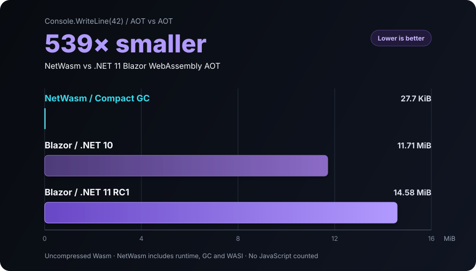

# NetWasm

**Independent .NET for WebAssembly and WASI.**<br>
Write C#. Use your NuGet packages. Deploy small, standalone Wasm.

NetWasm is an independent compiler, CoreLib, runtime and SDK that compiles C#
and .NET CIL directly to WebAssembly. It does not carry the desktop CLR, Mono,
`dotnet.js` or application DLLs into production.

[](https://github.com/zion-sati/NetWasm)
[](https://github.com/zion-sati/NetWasm/actions/workflows/release.yml)
[](https://github.com/zion-sati/NetWasm/actions/workflows/release.yml)
[](docs/licensing.md)

[Compile C# to WebAssembly](https://www.netwasm.com/compile-csharp-to-webassembly/) ·
[Try it in the browser](https://playground.netwasm.com/) ·
[Install and build](#try-it) ·
[See supported APIs](docs/support-status.md) ·
[Read the documentation](docs/README.md)

## Your NuGet packages, native ones included

A NetWasm project targets `net10.0-netwasm`, a .NET platform target framework
like Blazor's `net10.0-browser`. NuGet restores each package's `net10.0`,
`net9.0`, `net8.0` or .NET Standard build, newest first, as it does for any
.NET 10 project, so a package needs no NetWasm build of its own. Of 100 of the
most-downloaded nuget.org packages that ship a .NET Standard build, **56 run
their README quick start unchanged**, printing exactly what desktop .NET
prints: Azure.Core, the AWS SDK's core, MSAL, CsvHelper, MongoDB.Driver, gRPC's
client, RabbitMQ.Client, Open XML SDK, BouncyCastle, SSH.NET and
HtmlAgilityPack among them. Most of the rest stop on run-time reflection, which
NetWasm leaves out to keep programs small, and several have a source-generated
replacement that runs.

Packages that carry native code come along too. The static archives SkiaSharp
and HarfBuzzSharp ship for .NET's WebAssembly SDKs link into the program as
they are, and **Avalonia 12's headless platform renders the same frame as on
desktop .NET**, through Skia, with no change to Avalonia.

[Every package's result and the replacements](docs/package-compatibility.md) ·
[How packages restore, and what stops them](docs/netstandard-libraries.md)

## C# at less than half Rust's Wasm size

**NetWasm + precise GC: 28,383 bytes**<br>
**Rust 1.100.0 size-oriented profile: 63,528 bytes**

For the same print-`42` workload, NetWasm's result includes the runtime and
precise Compact garbage collector. Both artifacts are standalone WASI 0.3
components, built the way a developer gets them out of the box: each
toolchain's standard library and ordinary build, with no hand-added tools.

**55.3% smaller raw. 38.6% smaller with Brotli-11.**


| Toolchain | Raw Wasm | Brotli 11 | Comparison role |
| --- | ---: | ---: | --- |
| **NetWasm, Compact GC** | **28,383 B** | **11,992 B** | WASI 0.3 component; precise GC included |
| Rust 1.100.0, size profile | 63,528 B | 19,519 B | Matched WASI 0.3 component reference |
| *Rust 1.100.0, size profile* | *53,382 B* | *16,725 B* | *WASI 0.2 component, for context* |
| Kotlin 2.4.0 `wasmWasi` | 79,293 B | 22,655 B | P1 context; GC supplied by the host engine |
| TinyGo 0.39.0 | 93,043 B | 26,931 B | P1 context; precise GC configured |

Rust is the headline comparison because it uses the same workload and output
form. Rust's WASI 0.2 build, Kotlin/Wasm and TinyGo show the broader footprint landscape, but their
targets and runtime boundaries differ. This is a measured workload/profile
result, not a language-wide size ranking.

NetWasm's figure is the template application's default Release publish. Rust's
adds Cargo's documented size settings (`opt-level = "z"`, LTO, one codegen
unit, `panic = "abort"` and stripped symbols) to an ordinary `cargo build`.
Binaryen's wasm-opt is not a post-processing step here: it is part of NetWasm's
compiler pipeline and runs in every ordinary build, with nothing to install or
enable. Rust's output is a component, so applying wasm-opt to it means
extracting the core module, optimizing it and re-encoding the component by
hand. For Rust 1.100.0's WASI 0.3 target that route does not yet produce a
component that runs. For its WASI 0.2 target it does: with every custom section
stripped as well, the component is 41,185 bytes (14,523 with Brotli-11), still
larger than NetWasm's ordinary publish.

Both languages can go lower, but that is a different class of program: Rust
with `no_std`, or C# with a minimal library such as bflat's zero library, each
giving up most of the standard library and, for C#, the garbage collector.

[Exact sources, versions, settings and reproduction steps](docs/size-and-methodology.md)

## Faster than Mono AOT and the desktop JIT

NetWasm runs our allocation and garbage-collection benchmarks faster than Mono
AOT, compiled from the same C# source and run by the same Wasmtime. It is also
faster than desktop .NET 11's JIT and NativeAOT on all three, although desktop
.NET runs native code outside any Wasm sandbox:

| Workload | NetWasm, NetWasmGC | Mono AOT, .NET 11 | Desktop .NET 11 JIT | Desktop .NET 11 NativeAOT |
| --- | ---: | ---: | ---: | ---: |
| Full transaction | **27.3 ms** | 57.4 ms | 51.1 ms | 33.7 ms |
| Retained object graph | **4.1 ms** | 14.5 ms | 10.1 ms | 7.9 ms |
| UI churn | **5.5 ms** | 27.4 ms | 9.0 ms | 6.9 ms |

These are medians of 15 runs on an Apple M1 Max, with every Wasm build under
Wasmtime 50.0.1 and each run checked against desktop .NET's result. Mono AOT is
Microsoft's `wasi-wasm` target on .NET 11 in Release, with Wasm SIMD.
NetWasmGC takes 52% to 80% less time than Mono AOT, 39% to 60% less than the
desktop JIT and 19% to 49% less than desktop NativeAOT.

Without allocation in the timed region, NetWasm takes 42% less time than Mono AOT
on the transaction's library work, 10% less on a quicksort and 2% less on an
n-body kernel, and runs a CRC-32 kernel at the same speed. Desktop .NET is
faster on the library work and the quicksort without allocation.

[Versions, settings, desktop figures and reproduction](docs/performance.md)

## More than Hello World

Hello World is just the smallest example. NetWasm builds real applications too.

**C# 15** · **JavaScript modules and Web Workers** · **static `.a` interop** · **WIT/WASI 0.3** ·
**expression trees** · **HTTP/JSON/XML/Regex** · **reflection-free DI** ·
**TUnit/VSTest** · **TLS and HTTP/2** · **Avalonia** · **wasm64** · **four allocation strategies**

Today NetWasm can:

- build, run, publish and test projects through the ordinary `dotnet` CLI;
- publish C# exports as typed [JavaScript modules](docs/javascript-interop.md)
  that run in the page or in a [Web Worker](docs/web-workers.md), work with the
  [DOM and Canvas](docs/dom-and-canvas.md) from C#, and use libraries built for
  the browser by .NET's SDK, their `[JSImport]` and `[JSExport]` methods
  included;
- link the [native archives](docs/static-native-interop.md) packages built by
  Emscripten ship, SkiaSharp's and HarfBuzzSharp's among them, and marshal
  handles, strings and structs to native code as desktop .NET does;
- [generate C# bindings from WIT](docs/wit-bindings.md) and produce standalone
  WASI 0.3 components;
- construct and inspect expression trees without general runtime reflection;
- use LINQ, HTTP, JSON, XML and regular expressions from the framework, with
  TLS through `SslStream` and HTTP/2 and `wss://` WebSockets where the host
  provides `wasi:tls`, and dependency injection and configuration binding from
  NetWasm.Libraries;
- reference NuGet packages built for .NET 10 and earlier or .NET Standard: 56
  of 100 popular packages [run unchanged](docs/package-compatibility.md);
- dual-target libraries for `net10.0-netwasm` and desktop .NET.

The profile is deliberately smaller than desktop .NET. It already supports
complete applications, portable libraries, test projects and browser modules.

Built with NetWasm:

- **[DoomSharp](https://github.com/davidfowl/doomsharp)** by David Fowler, a
  clean-room classic WAD game engine in C#, has a NetWasm browser build you can
  [play](https://davidfowl.github.io/doomsharp/netwasm/). Built with NetWasm
  0.11.1 at `O3` with NetWasmGC
  ([davidfowl/doomsharp#60](https://github.com/davidfowl/doomsharp/pull/60)), it
  renders 120 frames 1.28 times faster than DoomSharp's Blazor AOT build in
  headless Chromium (1,750 ms against 2,236 ms on an Apple M1 Max), from
  0.69 MiB of Brotli-compressed files against 3.67 MiB.
- **[NetWasm.UI](https://github.com/matengo/NetWasm.UI)** by Mattias Engman,
  a signal-driven C# UI framework for the browser in the style of Solid and
  Svelte: components build their DOM once, and signals patch only the nodes
  that changed. Its `.nwui` templates compile at build time, and its
  [website](https://matengo.github.io/NetWasm.UI/) is a NetWasm.UI app.
- **[FUI-CS](https://github.com/zion-sati/fui-cs)**, the C# SDK for EffinDOM's
  retained-mode canvas UI, compiles every route of its
  [live demo](https://fui-cs-demo.effindom.dev/) to WebAssembly with NetWasm.

## Try it

Install [.NET SDK 10.0.303 or newer](https://dotnet.microsoft.com/download/dotnet/10.0),
then run:

```sh
dotnet new install NetWasm.Templates
dotnet new netwasm-app -n HelloNetWasm
cd HelloNetWasm
dotnet restore
dotnet run
dotnet publish -c Release -o publish/local
```

Run the published folder with Node.js, or the component with a WASI 0.3 host
such as [Wasmtime](https://wasmtime.dev/):

```sh
node publish/local/netwasm.host.mjs
wasmtime run -Wcomponent-model-async -Sp3 publish/local/HelloNetWasm.wasm
```

```text
42
```

The published component is self-contained with respect to .NET. A WebAssembly
host is still required. **Build with .NET; run without .NET.**

Projects using C# 15 select the .NET 11 SDK; earlier language versions can stay
on .NET 10. The SDK restores its pinned Node, LLD and Binaryen tools through
NuGet, so an ordinary app does not require a separate Emscripten, Git or Python
installation. [Getting started](docs/getting-started.md) walks through a
console program and a web page, the [configuration reference](docs/configuration.md)
lists every setting, and the [complete quickstart](docs/sdk-quickstart.md) covers
host, restore, Windows, browser and dual-targeting details.

## How it stays small

Roslyn produces CIL. NetWasm compiles the reachable program directly to Wasm,
specializes its generics and links only the runtime support it needs. The linked
Wasm component is the program.

- **Closed-world compilation.** Unreachable code, imports and runtime features
  do not enter the artifact.
- **A smaller platform contract.** NetWasm supports portable APIs instead of
  reproducing every desktop runtime assumption.
- **No broad runtime reflection.** A program carries no type names (they read
  `type#<id>` unless the build ships them in a sidecar), and dynamic assembly
  loading and the `dynamic` keyword are outside the profile.
- **Generated boundaries.** JSON, DI, WIT and native interop use known contracts
  rather than runtime discovery.
- **Optional data and diagnostics.** Timezone data, type names, rich stack
  traces and other deployment data are included only when selected.
- **One collector.** Only the chosen allocation strategy is linked.

This is a new .NET platform, not desktop .NET squeezed into a Wasm sandbox.
That boundary is what makes native-Wasm-sized C# possible.

[How JSON and optional features affect size](docs/size-and-methodology.md#json-is-not-one-fixed-cost)

## Choose your allocation strategy

Compact is the default: a size-first, precise, non-moving mark-and-sweep
collector. It traces compiler-published roots and reference layouts without
conservative scanning. Its name refers to implementation size, not moving heap
compaction.

| Strategy | Best fit | Raw component | Brotli 11 |
| --- | --- | ---: | ---: |
| **Compact (default)** | Small applications and low-churn UI | **28,383 B** | **11,992 B** |
| NetWasmGC | Higher allocation throughput | 32,159 B | 13,478 B |
| Bump | Bounded, one-shot jobs | 23,810 B | 9,870 B |

Select a strategy in the executable project's `.csproj`:

```xml
<PropertyGroup>
  <NetWasmGarbageCollector>NetWasm</NetWasmGarbageCollector>
</PropertyGroup>
```

With any of the tracing collectors, a page, a worker and a component's event
loop collect while the program waits, so collections land between interactions
rather than inside them.

Leaving the property unset selects Compact. Libraries remain collector-neutral;
all four backends are packaged for wasm32 and wasm64. See
[Choosing a garbage collector](docs/runtime-garbage-collection.md) for the
tradeoffs and diagnostics.

**NetWasmGen** is NetWasmGC with generations. Most of its collections look only
at the objects allocated since the last one and at the old objects the program
stored a reference into, so a program that keeps a large set of objects alive
while short-lived ones come and go runs **up to three times as fast** as under
NetWasmGC, and binary-trees 1.6 to 1.8 times as fast. Choose it for a service
answering requests against in-memory state, a game or simulation making garbage
every frame, or a compiler building and discarding trees; stay on NetWasmGC for
short runs and for data that dies all at once. Across 57 garbage-collection
programs it takes 0.93 of NetWasmGC's time.
[When to choose NetWasmGen](docs/runtime-garbage-collection.md#when-to-choose-netwasmgen)

## Libraries should travel upward

A library written for the smaller NetWasm profile should also be useful on
desktop .NET, rather than trapped in a Wasm-only ecosystem.

```sh
dotnet new netwasm-lib -n MyLibrary
```

The template targets `net10.0-netwasm` and `net10.0`, producing NuGet assets for
both platforms. This is explicit multi-targeting, not a promise that arbitrary
desktop packages work in reverse.

[NetWasm.Libraries](https://github.com/zion-sati/NetWasm.Libraries) provides the
ported framework and extensions packages.
[TUnit-NetWasm](https://github.com/zion-sati/TUnit-NetWasm) provides ordinary
`dotnet test` integration through the generic VSTest bridge, for test projects
that target `net10.0-netwasm`.

## How does this compare to conventional .NET Wasm?

For an empty-UI Blazor WebAssembly application that prints `42`, with AOT,
managed trimming, IL stripping, invariant globalization and size-focused native
linking enabled:



| AOT build | Uncompressed Wasm | Relative to NetWasm |
| --- | ---: | ---: |
| **NetWasm, Compact GC** | **28,383 B** | **1×** |
| Blazor WebAssembly, .NET 10 | 12,276,684 B | 433× |
| Blazor WebAssembly, .NET 11 RC1 | 15,289,241 B | 539× |

The Blazor total includes its native runtime and required Webcil assemblies;
NetWasm includes its runtime, garbage collector and WASI component. This is a
console component versus an empty-UI application, not an equivalent-framework
comparison or a claim about every .NET workload.

[Exact Blazor versions, settings and reproduction](docs/size-and-methodology.md#blazor-webassembly-aot-printing-42)

## Current boundary

NetWasm is pre-1.0. Its supported profile is usable today and covered by
published qualification, but source, package, target-profile and ABI contracts
may change between minor releases.

The normal portable output is a wasm32 WASI 0.3 Component. Raw wasm32,
raw wasm64 and JavaScript-host integration are advanced alternatives; wasm64
Components remain blocked by upstream tooling.

Runtime reflection, `dynamic`, runtime assembly loading and managed threading
are outside the profile, and so are child processes. Existing NuGet packages,
including those built for .NET Standard, work when their reachable code and API
dependencies fit the supported profile.

[Supported APIs and limitations](docs/support-status.md) ·
[Documentation index](docs/index.md)

## Road to 1.0

NetWasm 1.0 means a useful, documented and stable smaller platform. It does not
mean “desktop .NET, but in Wasm.” The main themes are:

- ✅ WASI 0.3, with broader WASI coverage (NetWasm 0.12.0);
- globalization modes and optional culture data;
- expression-tree completion;
- runtime async, for faster and smaller async programs;
- ✅ a faster incremental development loop (NetWasm 0.11.0);
- a stable platform and runtime contract;
- production diagnostics and broader host qualification.

**Done in NetWasm 0.14.0:** libraries built for .NET Standard restore from
NuGet and run unchanged when their reachable code fits the NetWasm profile,
without carrying unused unsupported paths into the application; see
[.NET Standard libraries](docs/netstandard-libraries.md) and how the
[most popular packages](docs/package-compatibility.md) fare.

This does not turn NetWasm into desktop .NET. General runtime reflection,
`dynamic`, runtime assembly loading, managed threading, unsupported host APIs
and named-culture globalization remain outside the profile; most such
operations still compile, and throw `PlatformNotSupportedException` when they
run.

[Read the full 1.0 roadmap](docs/roadmap.md)

## Changelog

| Version | What's new |
| --- | --- |
| [0.15.0](docs/releases/0.15.0.md) | Projects target `net10.0-netwasm`, so NuGet takes a package's newest .NET build. Static archives built by Emscripten link as they are, a program can read manifest resources and name its assemblies, and Avalonia 12's headless platform renders through Skia. |
| [0.14.2](docs/releases/0.14.2.md) | A program built with the Bump collector can use `ArrayPool<T>.Shared` again, along with finalizers, weak references and `ConditionalWeakTable`: finalizers never run and weak references never clear, since Bump never reclaims an object. |
| [0.14.1](docs/releases/0.14.1.md) | A method builds at `O3` when inlining into it would make its WebAssembly function larger than browsers and Node accept, instead of failing with `NW1013`. |
| [0.14.0](docs/releases/0.14.0.md) | A `netwasm0.1` project references the whole framework, so NuGet packages built for .NET Standard restore and compile against it. Date and time text, floating-point formatting and cookies are upstream .NET's, expression trees run nested lambdas and closures, and .NET's feature switches fold at compile time, so event logging costs nothing while it is off. |
| [0.13.0](docs/releases/0.13.0.md) | Programs no longer carry type names, which read `type#<id>` unless a file beside the program supplies them. Calls through unmanaged function pointers, async programs about half the size, the program that prints 42 23% smaller, and console output that JavaScript hosts no longer lose. |
| [0.12.2](docs/releases/0.12.2.md) | `dotnet run` and NetWasm's other Node.js hosts run programs that use sockets, and a call into a program costs the same however much it keeps alive: calls no longer collect garbage on their own, and finalizers, weak references, GC handles and pending asynchronous work are tracked in constant time. |
| [0.12.1](docs/releases/0.12.1.md) | A program ends with the exit code desktop .NET gives it, and `Environment.Exit`, `Environment.ExitCode` and `Environment.FailFast` are supported. |

[Full changelog](docs/changelog.md)

## Packages

<details>
<summary>Compiler, SDK, runtime and hosting packages</summary>

[NetWasm.Compiler.Browser](https://www.nuget.org/packages/NetWasm.Compiler.Browser) ·
[NetWasm.Compiler.Tasks](https://www.nuget.org/packages/NetWasm.Compiler.Tasks) ·
[NetWasm.Hosting](https://www.nuget.org/packages/NetWasm.Hosting) ·
[NetWasm.Hosting.Build](https://www.nuget.org/packages/NetWasm.Hosting.Build) ·
[NetWasm.Ref](https://www.nuget.org/packages/NetWasm.Ref) ·
[NetWasm.Runtime.Pack](https://www.nuget.org/packages/NetWasm.Runtime.Pack) ·
[NetWasm.Runtime.Wasm32](https://www.nuget.org/packages/NetWasm.Runtime.Wasm32) ·
[NetWasm.Runtime.Wasm64](https://www.nuget.org/packages/NetWasm.Runtime.Wasm64) ·
[NetWasm.Sdk](https://www.nuget.org/packages/NetWasm.Sdk) ·
[NetWasm.Templates](https://www.nuget.org/packages/NetWasm.Templates) ·
[NetWasm.Testing.VSTest](https://www.nuget.org/packages/NetWasm.Testing.VSTest) ·
[NetWasm.Toolchain](https://www.nuget.org/packages/NetWasm.Toolchain) ·
[NetWasm.Wit.Bindings.Tool](https://www.nuget.org/packages/NetWasm.Wit.Bindings.Tool)

[Ported-library packages](https://github.com/zion-sati/NetWasm.Libraries#packages) ·
[TUnit packages](https://github.com/zion-sati/TUnit-NetWasm#netwasm-packages)

</details>

## License

The compiler and the surrounding tools that create your deployable package,
with their tests, use the [NetWasm Community License
1.0](LICENSES/LicenseRef-NetWasm-Community-1.0.txt). Everything else is MIT,
subject to preserved upstream notices, including all code you need to deploy
an application: CoreLib, runtime libraries, the JavaScript host, templates and
generated support code. The Compact and NetWasmGC collectors are Apache-2.0.

The Community License is free for individuals, education, open-source projects,
evaluation, and small and medium-sized businesses: any organization with fewer
than 250 employees and less than USD 10,000,000 in annual revenue. Larger
organizations pay for internal commercial use by sponsoring a matching [GitHub
Sponsors tier](https://github.com/sponsors/zion-sati), from USD 149 a month for
five developers up to USD 2,499 a month for unlimited developers. OEM and
Commercial Offering use require a separate agreement. Generated applications
may use their authors' chosen licenses. The sponsorship itself is the license:
there is no license key, sign-in, activation, telemetry or technical
enforcement.

[Licensing guide](docs/licensing.md) ·
[Third-party notices](THIRD-PARTY-NOTICES.md) ·
Commercial licensing: <zion.sati@netwasm.com>

## Bring a workload

Start with `Console.WriteLine(42)`, then try the smallest real workload where
deployment size, sandboxing or portability matters. If something is missing,
open an [issue](https://github.com/zion-sati/NetWasm/issues). Concrete workloads
are how the 1.0 support boundary gets decided.
