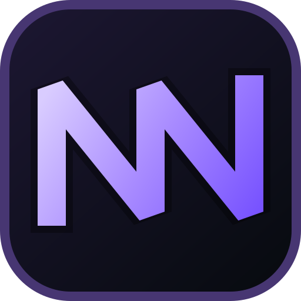

<p align="center"></p>

# NetWasm

**Independent .NET for WebAssembly and WASI.**<br>
Write C#. Use your NuGet packages. Deploy small, standalone Wasm.

NetWasm is an independent compiler, CoreLib, runtime and SDK that compiles C#
and .NET CIL directly to WebAssembly: one `.wasm` file holding your program, the
parts of .NET it uses and a garbage collector. It does not carry the desktop
CLR, Mono, `dotnet.js` or application DLLs into production. It is a compiler,
not a UI framework: for browser UI, call the DOM from C# or use
[NetWasm.UI](https://github.com/matengo/NetWasm.UI).

[](https://github.com/zion-sati/NetWasm)
[](https://github.com/zion-sati/NetWasm/actions/workflows/release.yml)
[](https://github.com/zion-sati/NetWasm/actions/workflows/release.yml)
[](docs/licensing.md)

[Compile C# to WebAssembly](https://www.netwasm.com/compile-csharp-to-webassembly/) ·
[Try it in the browser](https://playground.netwasm.com/) ·
[Get started](#get-started) ·
[See supported APIs](docs/support-status.md) ·
[Read the documentation](docs/README.md)

> **Pre-1.0, usable today.** Packages are on NuGet.org, and every release passes
> NetWasm's full compiler test suite. A minor release can still change APIs and
> build output, and its notes list every breaking change. Everything you deploy
> (CoreLib, the runtime, the JavaScript host) is MIT; the compiler is free for
> individuals, open source, education and organizations with fewer than 250
> employees and under USD 10 million in revenue. See [License](#license).

## Is it a fit?

| Good fit | Not a fit |
| --- | --- |
| C# logic in a web page or a Web Worker, called from JavaScript | Run-time reflection over members, `dynamic` and loading assemblies at run time, which NetWasm leaves out by design: compiling only the code a program can reach is what keeps it small |
| HTTP services and functions for WASI hosts such as Wasmtime, Spin and wasmCloud | Libraries built on run-time reflection, such as Entity Framework |
| Command-line tools and plugins that run in a sandbox | ASP.NET Core, whose shared framework NetWasm does not provide |
| NuGet packages whose reachable code avoids run-time reflection: 56 of 100 popular packages run unchanged | Managed threads, parallel work and child processes |

## Get started

Install the [.NET SDK](https://dotnet.microsoft.com/download/dotnet/10.0),
10.0.303 or newer, then:

```sh
dotnet new install NetWasm.Templates
dotnet new netwasm-app -n Hello
cd Hello
dotnet run
```

It prints `42`. `dotnet publish -c Release -o publish/local` writes `Hello.wasm`,
which any WASI 0.3 host runs, and a launcher for Node.js:

```sh
wasmtime run publish/local/Hello.wasm
node publish/local/netwasm.host.mjs
```

For a web page, add `--host page` to `dotnet new`; `dotnet run` then serves the
page on `http://localhost:5080/`. The first restore downloads the compiler, the
linker and Binaryen for your machine as a NuGet package, so there is nothing
else to install. [Getting started](docs/getting-started.md) goes step by step.

## Quick look

It is ordinary C#. A page's C# exports methods to JavaScript and imports
JavaScript functions, with .NET's own attributes:

```csharp
using System.Runtime.InteropServices.JavaScript;

public static partial class PageExports
{
    [JSImport("show", "app.host")]
    private static extern void Show(string message);

    [JSExport("greet")]
    public static string Greet(string name)
    {
        var message = $"Hello, {name}, from C#.";
        Show(message);
        return message;
    }
}
```

The build turns it into a typed JavaScript module for the page:

```js
import { open } from "./browser/Hello.mjs";

const app = await open();
app.greet("browser"); // runs the C# above, which calls show() on the page
```

and `show` is your own JavaScript, with the DOM at hand:

```js
export function show(message) {
  document.querySelector("#result").textContent = message;
}
```

[JavaScript interop](docs/javascript-interop.md) ·
[Web Workers](docs/web-workers.md) ·
[HTTP services](docs/http-services.md) ·
[What a project can build](docs/project-kinds.md)

## C# at less than half Rust's Wasm size

**NetWasm + precise GC: 27,583 bytes**<br>
**Rust 1.100.0 size-oriented profile: 63,528 bytes**

For the same print-`42` workload, NetWasm's result includes the runtime and
precise Compact garbage collector. Both artifacts are standalone WASI 0.3
components, built the way a developer gets them out of the box: each
toolchain's standard library and ordinary build, with no hand-added tools.

**56.6% smaller raw. 41.0% smaller with Brotli-11.**


| Toolchain | Raw Wasm | Brotli 11 | Comparison role |
| --- | ---: | ---: | --- |
| **NetWasm, Compact GC** | **27,583 B** | **11,525 B** | WASI 0.3 component; precise GC included |
| Rust 1.100.0, size profile | 63,528 B | 19,519 B | Matched WASI 0.3 component reference |
| *Rust 1.100.0, size profile* | *53,382 B* | *16,725 B* | *WASI 0.2 component, for context* |
| Kotlin 2.4.0 `wasmWasi` | 79,293 B | 22,655 B | P1 context; GC supplied by the host engine |
| TinyGo 0.39.0 | 93,043 B | 26,931 B | P1 context; precise GC configured |

NetWasm's figure is the template's default Release publish; Rust's adds Cargo's
documented size settings. A real program is bigger and still one file: the
[HTTP service](docs/http-services.md) template, with .NET's HTTP stack, is a
1,176,838-byte component, 262,723 bytes with Brotli, that `wasmtime serve` runs
as it is. [Sources, settings and reproduction](docs/size-and-methodology.md)

## Your NuGet packages, native ones included

A NetWasm project targets `net10.0-netwasm`, a .NET platform target framework
like Blazor's `net10.0-browser`. NuGet restores each package's `net10.0`,
`net9.0`, `net8.0` or .NET Standard build, newest first, as it does for any
.NET 10 project, so a package needs no NetWasm build of its own. Of 100 of the
most-downloaded nuget.org packages that ship a .NET Standard build, **56 run
their README quick start unchanged**, printing exactly what desktop .NET
prints: Azure.Core, the AWS SDK's core, MSAL, CsvHelper, MongoDB.Driver, gRPC's
client, RabbitMQ.Client, Open XML SDK, BouncyCastle, SSH.NET and
HtmlAgilityPack among them. Most of the rest stop on run-time reflection, which
NetWasm leaves out to keep programs small, and several have a source-generated
replacement that runs.

Packages that carry native code come along too. The static archives SkiaSharp
and HarfBuzzSharp ship for .NET's WebAssembly SDKs link into the program as
they are, and **Avalonia 12's headless platform renders the same frame as on
desktop .NET**, through Skia, with no change to Avalonia.

[Every package's result and the replacements](docs/package-compatibility.md) ·
[How packages restore, and what stops them](docs/netstandard-libraries.md)

## More than three times as fast as Mono AOT

Across 2,213 micro-benchmark cases, dotnet/performance's and NetWasm's own,
NetWasm runs **more than three times as fast as Mono AOT** (geometric mean),
compiled from the same C# and run by the same Wasmtime, and at about two-thirds
of the speed of desktop .NET 11's JIT, which runs native code outside any
sandbox.
[Every case](docs/micro-benchmarks.md)

A real application too: David Fowler's [DoomSharp](https://github.com/davidfowl/doomsharp)
renders about 1.4 times as fast as its Mono AOT build in the browser, from an
eighth of the download.


On allocation and garbage-collection workloads NetWasmGC is **2 to 5 times as
fast as Mono AOT**, and beats native code too:

| Workload | NetWasm, NetWasmGC | Mono AOT, .NET 11 | Desktop .NET 11 JIT | Desktop .NET 11 NativeAOT |
| --- | ---: | ---: | ---: | ---: |
| Full transaction | **27.3 ms** | 57.4 ms | 51.1 ms | 33.7 ms |
| Retained object graph | **4.1 ms** | 14.5 ms | 10.1 ms | 7.9 ms |
| UI churn | **5.5 ms** | 27.4 ms | 9.0 ms | 6.9 ms |

Medians of 15 runs on an Apple M1 Max, under Wasmtime 50.0.1, each checked
against desktop .NET's result. [Versions, settings and reproduction](docs/performance.md)

## Choose your garbage collector

Four collectors, one property. Compact, the default, is a size-first, precise,
non-moving mark-and-sweep collector; its name refers to implementation size,
not moving heap compaction. NetWasmGC trades a few kilobytes for faster
allocation and collection, and **NetWasmGen** adds generations to it. Every
tracing collector follows compiler-published roots and reference layouts,
without conservative scanning.

| Collector | Best fit | Raw component | Brotli 11 |
| --- | --- | ---: | ---: |
| **Compact (default)** | Small applications and low-churn UI | **27,583 B** | **11,525 B** |
| NetWasmGC | Higher allocation throughput | 31,588 B | 13,312 B |
| **NetWasmGen** | A large live heap with short-lived garbage on top: **up to 3 times NetWasmGC's speed** | 34,930 B | 14,709 B |
| Bump | Bounded, one-shot jobs | 22,981 B | 9,523 B |

**NetWasmGen** is NetWasmGC with generations. Most of its collections look only
at the objects allocated since the last one and at the old objects the program
stored a reference into, so a program that keeps a large set of objects alive
while short-lived ones come and go runs **up to three times as fast** as under
NetWasmGC, and binary-trees 1.6 to 1.8 times as fast. Choose it for a service
answering requests against in-memory state, a game or simulation making garbage
every frame, or a compiler building and discarding trees; stay on NetWasmGC for
short runs and for data that dies all at once. Across 57 garbage-collection
programs it takes 0.93 of NetWasmGC's time.
[When to choose NetWasmGen](docs/runtime-garbage-collection.md#when-to-choose-netwasmgen)

Select a collector in the executable project's `.csproj`:

```xml
<PropertyGroup>
  <NetWasmGarbageCollector>NetWasmGen</NetWasmGarbageCollector>
</PropertyGroup>
```

The values are `Compact`, `NetWasm`, `NetWasmGen` and `Bump`; leaving the
property unset selects Compact. With any of the tracing collectors, a page, a
worker and a component's event loop collect while the program waits, so
collections land between interactions rather than inside them. Libraries remain
collector-neutral, and all four collectors are packaged for wasm32 and wasm64.
See [Choosing a garbage collector](docs/runtime-garbage-collection.md) for the
measurements, the tradeoffs and diagnostics.

## Built with NetWasm

- **[DoomSharp](https://github.com/davidfowl/doomsharp)** by David Fowler, a
  clean-room classic WAD game engine in C#, has a NetWasm browser build you can
  [play](https://doom-sharp.netwasm.com/netwasm/)
  ([source](https://github.com/zion-sati/doomsharp)). It renders frames
  **about 1.5 times as fast as Mono AOT**, in the browser and under Wasmtime,
  from an eighth of the download.
- **[NetWasm.UI](https://github.com/matengo/NetWasm.UI)** by Mattias Engman,
  a signal-driven C# UI framework for the browser in the style of Solid and
  Svelte: components build their DOM once, and signals patch only the nodes
  that changed. Its [website](https://matengo.github.io/NetWasm.UI/) is a
  NetWasm.UI app.
- **[FUI-CS](https://github.com/zion-sati/fui-cs)**, the C# SDK for EffinDOM's
  retained-mode canvas UI, compiles every route of its
  [live demo](https://fui-cs-demo.effindom.dev/) to WebAssembly with NetWasm.

## What else it does

**C# 15** · **JavaScript modules and Web Workers** · **native archives** · **WIT/WASI 0.3** ·
**HTTP/JSON/XML/Regex** · **TLS and HTTP/2** · **expression trees** · **reflection-free DI** ·
**TUnit/VSTest** · **Avalonia** · **wasm64** · **four garbage collectors**

- Build, run, publish and test with the ordinary `dotnet` CLI, `dotnet test`
  included, with TUnit or VSTest.
- Use libraries built for the browser by .NET's SDK, their `[JSImport]` and
  `[JSExport]` methods included, and [draw on a Canvas](docs/dom-and-canvas.md)
  every animation frame.
- Link the [native archives](docs/static-native-interop.md) packages built by
  Emscripten ship, and marshal handles, strings and structs to native code as
  desktop .NET does.
- [Generate C# from WIT](docs/wit-bindings.md) and build components for any
  WASI 0.3 host.
- Use LINQ, HTTP, JSON, XML and regular expressions from the framework, with
  `SslStream`, HTTP/2 and `wss://` WebSockets where the host provides
  `wasi:tls`, and dependency injection, logging, options and configuration
  binding from [NetWasm.Libraries](https://github.com/zion-sati/NetWasm.Libraries).
- Write libraries for `net10.0-netwasm` and desktop .NET at once:
  `dotnet new netwasm-lib`.

## How it stays small

Roslyn produces CIL. NetWasm compiles the reachable program directly to Wasm,
specializes its generics and links only the runtime support it needs.

- **Closed-world compilation.** Unreachable code, imports and runtime features
  do not enter the artifact.
- **A smaller platform contract.** NetWasm supports portable APIs instead of
  reproducing every desktop runtime assumption.
- **No broad runtime reflection.** A program carries no type names; one that
  reads them loads them from a file beside it. Loading assemblies at run time
  and the `dynamic` keyword are outside the profile.
- **Generated boundaries.** JSON, DI, WIT and native interop use known contracts
  rather than run-time discovery.
- **Optional data and diagnostics.** Time zone data, rich stack traces and other
  deployment data are included only when selected.
- **One collector.** Only the chosen collector is linked.

[How it works](docs/how-it-works.md) ·
[How JSON and optional features affect size](docs/size-and-methodology.md#json-is-not-one-fixed-cost)

## Requirements

| | |
| --- | --- |
| .NET SDK | 10.0.303 or newer, including .NET 11; C# 15 needs the .NET 11 SDK |
| Build machines | Linux x64 and ARM64, macOS ARM64, Windows x64 and ARM64 |
| Browsers | Chrome and Edge 137, Firefox 131, Safari 18.4, or newer |
| WASI hosts | Wasmtime 50, Spin, wasmCloud and other WASI 0.3 hosts |
| Node.js | 24.15 or newer, when you host the output in your own Node.js |

[Compatibility and versioning](docs/compatibility.md)

## Documentation

- [Getting started](docs/getting-started.md) and the [SDK quickstart](docs/sdk-quickstart.md)
- [What a project can build](docs/project-kinds.md): programs, page and worker modules, HTTP services, components
- [JavaScript interop](docs/javascript-interop.md), [DOM and Canvas](docs/dom-and-canvas.md) and [Web Workers](docs/web-workers.md)
- [HTTP services](docs/http-services.md) and [files, network and other host capabilities](docs/host-capabilities.md)
- [Packages and libraries](docs/netstandard-libraries.md) and the [most popular packages](docs/package-compatibility.md)
- [Native C libraries](docs/static-native-interop.md) and [WIT and components](docs/wit-bindings.md)
- [Garbage collectors](docs/runtime-garbage-collection.md) and [optimization](docs/optimization.md)
- [Publishing and deployment](docs/deployment.md), [security](docs/security.md) and [troubleshooting](docs/troubleshooting.md)
- [Configuration](docs/configuration.md), [support status](docs/support-status.md) and [every page](docs/README.md)

## Current boundary and the road to 1.0

NetWasm 1.0 means a useful, documented and stable smaller platform, not desktop
.NET in Wasm. Run-time reflection over members, `dynamic` and loading assemblies
at run time are left out by design and will stay out. Managed threading, child
processes and named-culture globalization are outside the profile too. Most
such operations still compile, and throw `PlatformNotSupportedException` when
they run. The normal portable output is a
wasm32 WASI 0.3 component; raw wasm32 and wasm64 modules serve JavaScript and
custom hosts.

Done: WASI 0.3, a fast incremental development loop, and NuGet packages under
`net10.0-netwasm`. Next: globalization modes and optional culture data,
expression-tree completion, runtime async, a stable platform and runtime
contract, and production diagnostics with broader host qualification.

[Supported APIs and limitations](docs/support-status.md) ·
[The 1.0 roadmap](docs/roadmap.md)

## Changelog

| Version | What's new |
| --- | --- |
| [0.15.0](docs/releases/0.15.0.md) | NuGet packages under `net10.0-netwasm`, native ones included; the generational NetWasmGen collector; collection while a program waits; TLS clients; interop as on .NET. |
| [0.14.2](docs/releases/0.14.2.md) | A program built with the Bump collector can use `ArrayPool<T>.Shared` again, along with finalizers, weak references and `ConditionalWeakTable`. |
| [0.14.1](docs/releases/0.14.1.md) | A method builds at `O3` when inlining into it would make its WebAssembly function larger than browsers and Node accept, instead of failing with `NW1013`. |

[Full changelog](docs/changelog.md)

## Packages

<details>
<summary>Compiler, SDK, runtime and hosting packages</summary>

[NetWasm.Compiler.Browser](https://www.nuget.org/packages/NetWasm.Compiler.Browser) ·
[NetWasm.Compiler.Tasks](https://www.nuget.org/packages/NetWasm.Compiler.Tasks) ·
[NetWasm.Hosting](https://www.nuget.org/packages/NetWasm.Hosting) ·
[NetWasm.Hosting.Build](https://www.nuget.org/packages/NetWasm.Hosting.Build) ·
[NetWasm.Ref](https://www.nuget.org/packages/NetWasm.Ref) ·
[NetWasm.Runtime.Pack](https://www.nuget.org/packages/NetWasm.Runtime.Pack) ·
[NetWasm.Runtime.Wasm32](https://www.nuget.org/packages/NetWasm.Runtime.Wasm32) ·
[NetWasm.Runtime.Wasm64](https://www.nuget.org/packages/NetWasm.Runtime.Wasm64) ·
[NetWasm.Sdk](https://www.nuget.org/packages/NetWasm.Sdk) ·
[NetWasm.Templates](https://www.nuget.org/packages/NetWasm.Templates) ·
[NetWasm.Testing.VSTest](https://www.nuget.org/packages/NetWasm.Testing.VSTest) ·
[NetWasm.Toolchain](https://www.nuget.org/packages/NetWasm.Toolchain) ·
[NetWasm.Wit.Bindings.Tool](https://www.nuget.org/packages/NetWasm.Wit.Bindings.Tool)

[Ported-library packages](https://github.com/zion-sati/NetWasm.Libraries#packages) ·
[TUnit packages](https://github.com/zion-sati/TUnit-NetWasm#netwasm-packages)

</details>

## License

The compiler and the surrounding tools that create your deployable package,
with their tests, use the [NetWasm Community License
1.0](LICENSES/LicenseRef-NetWasm-Community-1.0.txt). Everything else is MIT,
subject to preserved upstream notices, including all code you need to deploy
an application: CoreLib, runtime libraries, the JavaScript host, templates and
generated support code. The Compact and NetWasmGC collectors are Apache-2.0.

The Community License is free for individuals, education, open-source projects,
evaluation, and small and medium-sized businesses: any organization with fewer
than 250 employees and less than USD 10,000,000 in annual revenue. Larger
organizations pay for internal commercial use by sponsoring a matching [GitHub
Sponsors tier](https://github.com/sponsors/zion-sati), from USD 149 a month for
five developers up to USD 2,499 a month for unlimited developers. OEM and
Commercial Offering use require a separate agreement. Generated applications
may use their authors' chosen licenses. The sponsorship itself is the license:
there is no license key, sign-in, activation, telemetry or technical
enforcement.

[Licensing guide](docs/licensing.md) ·
[Third-party notices](THIRD-PARTY-NOTICES.md) ·
Commercial licensing: <zion.sati@netwasm.com>

## Bring a workload

Start with `Console.WriteLine(42)`, then try the smallest real workload where
deployment size, sandboxing or portability matters. If something is missing,
open an [issue](https://github.com/zion-sati/NetWasm/issues). Concrete workloads
are how the 1.0 support boundary gets decided.
