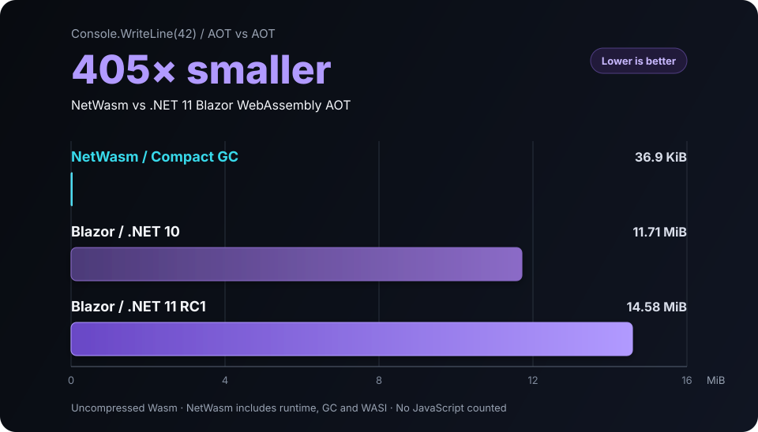

# NetWasm

**Independent .NET for WebAssembly and WASI.**<br>
Write C#. Deploy small, standalone Wasm.

NetWasm is an independent compiler, CoreLib, runtime and SDK that compiles C#
and .NET CIL directly to WebAssembly. It does not carry the desktop CLR, Mono,
`dotnet.js` or application DLLs into production.

[](https://github.com/zion-sati/NetWasm)
[](https://github.com/zion-sati/NetWasm/actions/workflows/release.yml)
[](https://github.com/zion-sati/NetWasm/actions/workflows/release.yml)
[](docs/licensing.md)

[Compile C# to WebAssembly](https://www.netwasm.com/compile-csharp-to-webassembly/) ·
[Try it in the browser](https://playground.netwasm.com/) ·
[Install and build](#try-it) ·
[See supported APIs](docs/support-status.md) ·
[Read the documentation](docs/index.md)

## C# now beats Rust on Wasm size

**NetWasm + precise GC: 39,151 bytes**<br>
**Rust 1.99.1 size-oriented profile: 52,569 bytes**

For the same print-`42` workload, NetWasm's result includes the runtime and
precise Compact garbage collector. Both artifacts are standalone WASI Preview 2
Components, built the way a developer gets them out of the box: each
toolchain's standard library and ordinary build, with no hand-added tools.

**25.5% smaller raw. 19.8% smaller with Brotli-11.**


| Toolchain | Raw Wasm | Brotli 11 | Comparison role |
| --- | ---: | ---: | --- |
| **NetWasm, Compact GC** | **39,151 B** | **13,355 B** | WASI P2 Component; precise GC included |
| Rust 1.99.1, size profile | 52,569 B | 16,648 B | Matched WASI P2 Component reference |
| Kotlin 2.4.0 `wasmWasi` | 79,293 B | 22,655 B | P1 context; GC supplied by the host engine |
| TinyGo 0.39.0 | 93,043 B | 26,931 B | P1 context; precise GC configured |

Rust is the headline comparison because it uses the same workload and output
form. Kotlin/Wasm and TinyGo show the broader footprint landscape, but their
targets and runtime boundaries differ. This is a measured workload/profile
result, not a language-wide size ranking.

NetWasm's figure is the template application's default Release publish. Rust's
adds Cargo's documented size settings (`opt-level = "z"`, LTO, one codegen
unit, `panic = "abort"` and stripped symbols) to an ordinary `cargo build`.
Binaryen's wasm-opt is not a post-processing step here: it is part of NetWasm's
compiler pipeline and runs in every ordinary build, with nothing to install or
enable. Rust's `wasm32-wasip2` output is a component, so applying wasm-opt to it
means extracting the core module, optimizing it and re-encoding the component
by hand. Done that way for Rust 1.99.1, with every custom section stripped as
well, the component is 40,488 bytes (14,390 with Brotli-11): still larger than
NetWasm's ordinary publish.

Both languages can go lower, but that is a different class of program: Rust
with `no_std`, or C# with a minimal library such as bflat's zero library, each
giving up most of the standard library and, for C#, the garbage collector.

[Exact sources, versions, settings and reproduction steps](docs/size-and-methodology.md)

## Faster than Mono AOT and the desktop JIT

NetWasm runs our allocation and garbage-collection benchmarks faster than Mono
AOT, compiled from the same C# source and run by the same Wasmtime. It is also
faster than desktop .NET 11's JIT on all three, although desktop .NET runs
native code outside any Wasm sandbox:

| Workload | NetWasm, NetWasmGC | Mono AOT, .NET 11 | Desktop .NET 11 JIT | Desktop .NET 11 NativeAOT |
| --- | ---: | ---: | ---: | ---: |
| Full transaction | **28.2 ms** | 56.6 ms | 49.8 ms | 32.4 ms |
| Retained object graph | **4.8 ms** | 14.4 ms | 9.8 ms | 7.6 ms |
| UI churn | **7.7 ms** | 27.0 ms | 8.7 ms | 6.7 ms |

These are medians of 15 runs on an Apple M1 Max, with every Wasm build under
Wasmtime 49.0.3 and each run checked against desktop .NET's result. Mono AOT is
Microsoft's `wasi-wasm` target on .NET 11 RC3 in Release, with Wasm SIMD.
NetWasmGC takes 50% to 71% less time than Mono AOT and 11% to 51% less than the
desktop JIT. It is also faster than desktop NativeAOT on the full transaction
and the retained object graph; NativeAOT is still faster on UI churn.

Without allocation in the timed region, NetWasm takes 41% less time than Mono AOT
on the transaction's library work and 7% less on a quicksort, and matches it on
n-body and CRC-32 kernels. Desktop .NET is faster on the library work and the
quicksort without allocation.

[Versions, settings, desktop figures and reproduction](docs/performance.md)

## More than Hello World

Hello World is just the smallest example. NetWasm builds real applications too.

**C# 15** · **JavaScript modules and Web Workers** · **static `.a` interop** · **WIT/WASI P2** ·
**expression trees** · **HTTP/JSON/XML/Regex** · **reflection-free DI** ·
**TUnit/VSTest** · **wasm64** · **three allocation strategies**

Today NetWasm can:

- build, run, publish and test projects through the ordinary `dotnet` CLI;
- publish C# exports as typed [JavaScript modules](docs/javascript-interop.md)
  that run in the page or in a [Web Worker](docs/web-workers.md);
- link compatible Wasm [`.a` archives](docs/static-native-interop.md) and
  generate bounded C ABI marshalling;
- [generate C# bindings from WIT](docs/wit-bindings.md) and produce standalone
  WASI P2 Components;
- construct and inspect expression trees without general runtime reflection;
- use independently packaged LINQ, HTTP, JSON, XML, Regex, Hashing and
  dependency-injection libraries;
- dual-target libraries for `netwasm0.1` and desktop .NET.

The profile is deliberately smaller than desktop .NET. It already supports
complete applications, portable libraries, test projects and browser modules.

Built with NetWasm:

- **[DoomSharp](https://github.com/davidfowl/doomsharp)** by David Fowler, a
  clean-room classic WAD game engine in C#, has a NetWasm browser build you can
  [play](https://davidfowl.github.io/doomsharp/netwasm/). Built with NetWasm
  0.11.1 at `O3` with NetWasmGC
  ([davidfowl/doomsharp#60](https://github.com/davidfowl/doomsharp/pull/60)), it
  renders 120 frames 1.28 times faster than DoomSharp's Blazor AOT build in
  headless Chromium (1,750 ms against 2,236 ms on an Apple M1 Max), from
  0.69 MiB of Brotli-compressed files against 3.67 MiB.
- **[NetWasm.UI](https://github.com/matengo/NetWasm.UI)** by Mattias Engman,
  a signal-driven C# UI framework for the browser in the style of Solid and
  Svelte: components build their DOM once, and signals patch only the nodes
  that changed. Its `.nwui` templates compile at build time, and its
  [website](https://matengo.github.io/NetWasm.UI/) is a NetWasm.UI app.
- **[FUI-CS](https://github.com/zion-sati/fui-cs)**, the C# SDK for EffinDOM's
  retained-mode canvas UI, compiles every route of its
  [live demo](https://fui-cs-demo.effindom.dev/) to WebAssembly with NetWasm.

## Try it

Install [.NET SDK 10.0.303 or newer](https://dotnet.microsoft.com/download/dotnet/10.0),
then run:

```sh
dotnet new install NetWasm.Templates
dotnet new netwasm-app -n HelloNetWasm
cd HelloNetWasm
dotnet restore
dotnet run
dotnet publish -c Release -o publish/local
```

Run the published folder with Node.js, or the component with a WASI 0.3 host
such as [Wasmtime](https://wasmtime.dev/):

```sh
node publish/local/netwasm.host.mjs
wasmtime run -Wcomponent-model-async -Sp3 publish/local/HelloNetWasm.wasm
```

```text
42
```

The published component is self-contained with respect to .NET. A WebAssembly
host is still required. **Build with .NET; run without .NET.**

Projects using C# 15 select the .NET 11 SDK; earlier language versions can stay
on .NET 10. The SDK restores its pinned Node, LLD and Binaryen tools through
NuGet, so an ordinary app does not require a separate Emscripten, Git or Python
installation. See the [complete quickstart](docs/sdk-quickstart.md) for host,
restore, Windows, browser and dual-targeting details.

## How it stays small

Roslyn produces CIL. NetWasm compiles the reachable program directly to Wasm,
specializes its generics and links only the runtime support it needs. The linked
Wasm component is the program.

- **Closed-world compilation.** Unreachable code, imports and runtime features
  do not enter the artifact.
- **A smaller platform contract.** NetWasm supports portable APIs instead of
  reproducing every desktop runtime assumption.
- **No broad runtime reflection.** Runtime type names, dynamic assembly loading
  and the `dynamic` keyword are outside the profile.
- **Generated boundaries.** JSON, DI, WIT and native interop use known contracts
  rather than runtime discovery.
- **Optional data and diagnostics.** Timezone data, rich stack traces and other
  deployment data are included only when selected.
- **One collector.** Only the chosen allocation strategy is linked.

This is a new .NET platform, not desktop .NET squeezed into a Wasm sandbox.
That boundary is what makes native-Wasm-sized C# possible.

[How JSON and optional features affect size](docs/size-and-methodology.md#json-is-not-one-fixed-cost)

## Choose your allocation strategy

Compact is the default: a size-first, precise, non-moving mark-and-sweep
collector. It traces compiler-published roots and reference layouts without
conservative scanning. Its name refers to implementation size, not moving heap
compaction.

| Strategy | Best fit | Raw component | Brotli 11 |
| --- | --- | ---: | ---: |
| **Compact (default)** | Small applications and low-churn UI | **39,151 B** | **13,355 B** |
| NetWasmGC | Higher allocation throughput | 42,298 B | 14,778 B |
| Bump | Bounded, one-shot jobs | 35,090 B | 11,650 B |

Select a strategy in the executable project's `.csproj`:

```xml
<PropertyGroup>
  <NetWasmGarbageCollector>NetWasm</NetWasmGarbageCollector>
</PropertyGroup>
```

Leaving the property unset selects Compact. Libraries remain collector-neutral;
all four backends are packaged for wasm32 and wasm64. See
[Choosing a garbage collector](docs/runtime-garbage-collection.md) for the
tradeoffs and diagnostics.

## Libraries should travel upward

A library written for the smaller NetWasm profile should also be useful on
desktop .NET, rather than trapped in a Wasm-only ecosystem.

```sh
dotnet new netwasm-lib -n MyLibrary
```

The template targets `netwasm0.1` and `net10.0`, producing NuGet assets for
both platforms. This is explicit multi-targeting, not a promise that arbitrary
desktop packages work in reverse.

[NetWasm.Libraries](https://github.com/zion-sati/NetWasm.Libraries) provides the
ported framework and extensions packages.
[TUnit-NetWasm](https://github.com/zion-sati/TUnit-NetWasm) provides ordinary
`dotnet test` integration through the generic VSTest bridge.

## How does this compare to conventional .NET Wasm?

For an empty-UI Blazor WebAssembly application that prints `42`, with AOT,
managed trimming, IL stripping, invariant globalization and size-focused native
linking enabled:



| AOT build | Uncompressed Wasm | Relative to NetWasm |
| --- | ---: | ---: |
| **NetWasm, Compact GC** | **39,151 B** | **1×** |
| Blazor WebAssembly, .NET 10 | 12,276,684 B | 314× |
| Blazor WebAssembly, .NET 11 RC1 | 15,289,241 B | 391× |

The Blazor total includes its native runtime and required Webcil assemblies;
NetWasm includes its runtime, garbage collector and WASI component. This is a
console component versus an empty-UI application, not an equivalent-framework
comparison or a claim about every .NET workload.

[Exact Blazor versions, settings and reproduction](docs/size-and-methodology.md#blazor-webassembly-aot-printing-42)

## Current boundary

NetWasm is pre-1.0. Its supported profile is usable today and covered by
published qualification, but source, package, target-profile and ABI contracts
may change between minor releases.

The normal portable output is a wasm32 WASI 0.3 Component. Raw wasm32,
raw wasm64 and JavaScript-host integration are advanced alternatives; wasm64
Components remain blocked by upstream tooling.

Runtime reflection, `dynamic`, runtime assembly loading and managed threading
are outside the profile. General `System.IO.File`/`Directory`/`FileStream`, raw
sockets and subprocess APIs are not yet implemented. Existing NuGet packages
work only when their reachable code and API dependencies fit the supported
profile.

[Supported APIs and limitations](docs/support-status.md) ·
[Documentation index](docs/index.md)

## Road to 1.0

NetWasm 1.0 means a useful, documented and stable smaller platform. It does not
mean “desktop .NET, but in Wasm.” The main themes are:

- ✅ WASI 0.3, with broader WASI coverage (NetWasm 0.12.0);
- globalization modes and optional culture data;
- expression-tree completion;
- ✅ a faster incremental development loop (NetWasm 0.11.0);
- a stable `netwasm1.0` platform and runtime contract;
- production diagnostics and broader host qualification.

**New in NetWasm 0.12.2:** a call into a program costs the same however much it keeps
alive: calls no longer collect garbage on their own, and finalizers, weak references, GC
handles and pending asynchronous work are tracked in constant time.
[Release notes](docs/releases/0.12.2.md). NetWasm 0.12.1 ends a program with the exit code
desktop .NET gives it, and adds `Environment.Exit`, `Environment.ExitCode` and
`Environment.FailFast`. [Release notes](docs/releases/0.12.1.md). NetWasm 0.12.0 made components target WASI 0.3, so ordinary .NET file,
socket and `HttpClient` code runs on the Component Model, and an HTTP service
is one `Handle` method that Wasmtime, Spin and wasmCloud run unchanged.
NetWasmGC allocates small objects inline, so a binary-trees benchmark takes
28% less time at `O3`. [Release notes](docs/releases/0.12.0.md). NetWasm 0.11.3 let static native
libraries use Wasm SIMD. [Release notes](docs/releases/0.11.3.md). NetWasm 0.11.2 brought faster delegate calls and span loops, and a
compiler that needs half the memory: a delegate call takes 38% less time, a
multicast invoke 44% less, and a fold over a span runs as Wasm SIMD vectors.
Compiling DoomSharp's browser build at `O3` peaks at 1.5 GB where 0.11.1 took 3.4 GB.
[Release notes](docs/releases/0.11.2.md). NetWasm 0.11.0
made Debug builds keep each method's compiled code, so a rebuild compiles only
what an edit changes: on DoomSharp's browser build, an edit to one method
rebuilds in 1.6 s where 0.10.8 took 29.3 s, and `dotnet watch` runs on NetWasm
projects. [Release notes](docs/releases/0.11.0.md)

**In progress:** broader compatibility with existing .NET Standard
2.1 library binaries and NuGet assets. The target is to consume libraries
unchanged when their reachable code fits the NetWasm profile, without carrying
unused unsupported paths into the application.

This does not turn NetWasm into desktop .NET. Reachable general runtime
reflection, `dynamic`, runtime assembly loading, managed threading, unsupported
host APIs and named-culture globalization remain outside the initial
compatibility slice and fail at compile time.

[Read the full 1.0 roadmap](docs/roadmap.md)

## Packages

<details>
<summary>Compiler, SDK, runtime and hosting packages</summary>

[NetWasm.Compiler.Browser](https://www.nuget.org/packages/NetWasm.Compiler.Browser) ·
[NetWasm.Compiler.Tasks](https://www.nuget.org/packages/NetWasm.Compiler.Tasks) ·
[NetWasm.Hosting](https://www.nuget.org/packages/NetWasm.Hosting) ·
[NetWasm.Hosting.Build](https://www.nuget.org/packages/NetWasm.Hosting.Build) ·
[NetWasm.Ref](https://www.nuget.org/packages/NetWasm.Ref) ·
[NetWasm.Runtime.Pack](https://www.nuget.org/packages/NetWasm.Runtime.Pack) ·
[NetWasm.Runtime.Wasm32](https://www.nuget.org/packages/NetWasm.Runtime.Wasm32) ·
[NetWasm.Runtime.Wasm64](https://www.nuget.org/packages/NetWasm.Runtime.Wasm64) ·
[NetWasm.Sdk](https://www.nuget.org/packages/NetWasm.Sdk) ·
[NetWasm.Templates](https://www.nuget.org/packages/NetWasm.Templates) ·
[NetWasm.Testing.VSTest](https://www.nuget.org/packages/NetWasm.Testing.VSTest) ·
[NetWasm.Toolchain](https://www.nuget.org/packages/NetWasm.Toolchain) ·
[NetWasm.Wit.Bindings.Tool](https://www.nuget.org/packages/NetWasm.Wit.Bindings.Tool)

[Ported-library packages](https://github.com/zion-sati/NetWasm.Libraries#packages) ·
[TUnit packages](https://github.com/zion-sati/TUnit-NetWasm#netwasm-packages)

</details>

## License

CoreLib, runtime libraries, templates and generated support code are MIT,
subject to preserved upstream notices. The compiler and developer tooling use
the [NetWasm Community License 1.0](LICENSES/LicenseRef-NetWasm-Community-1.0.txt).
The Compact and NetWasmGC collectors are Apache-2.0.

The Community License is free for individuals, education, open-source projects,
evaluation, and small and medium-sized businesses: any organization with fewer
than 250 employees and less than USD 10,000,000 in annual revenue. Larger
organizations pay for internal commercial use by sponsoring a matching [GitHub
Sponsors tier](https://github.com/sponsors/zion-sati), from USD 149 a month for
five developers up to USD 2,499 a month for unlimited developers. OEM and
Commercial Offering use require a separate agreement. Generated applications
may use their authors' chosen licenses. The sponsorship itself is the license:
there is no license key, sign-in, activation, telemetry or technical
enforcement.

[Licensing guide](docs/licensing.md) ·
[Third-party notices](THIRD-PARTY-NOTICES.md) ·
Commercial licensing: <zion.sati@netwasm.com>

## Bring a workload

Start with `Console.WriteLine(42)`, then try the smallest real workload where
deployment size, sandboxing or portability matters. If something is missing,
open an [issue](https://github.com/zion-sati/NetWasm/issues). Concrete workloads
are how the 1.0 support boundary gets decided.
